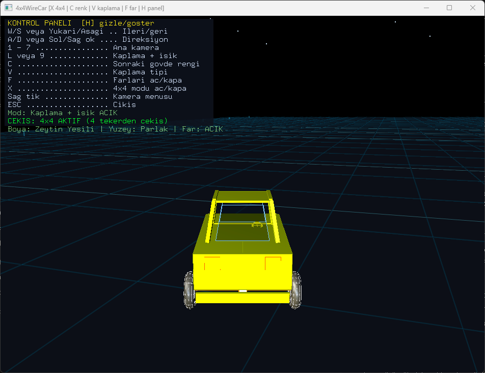
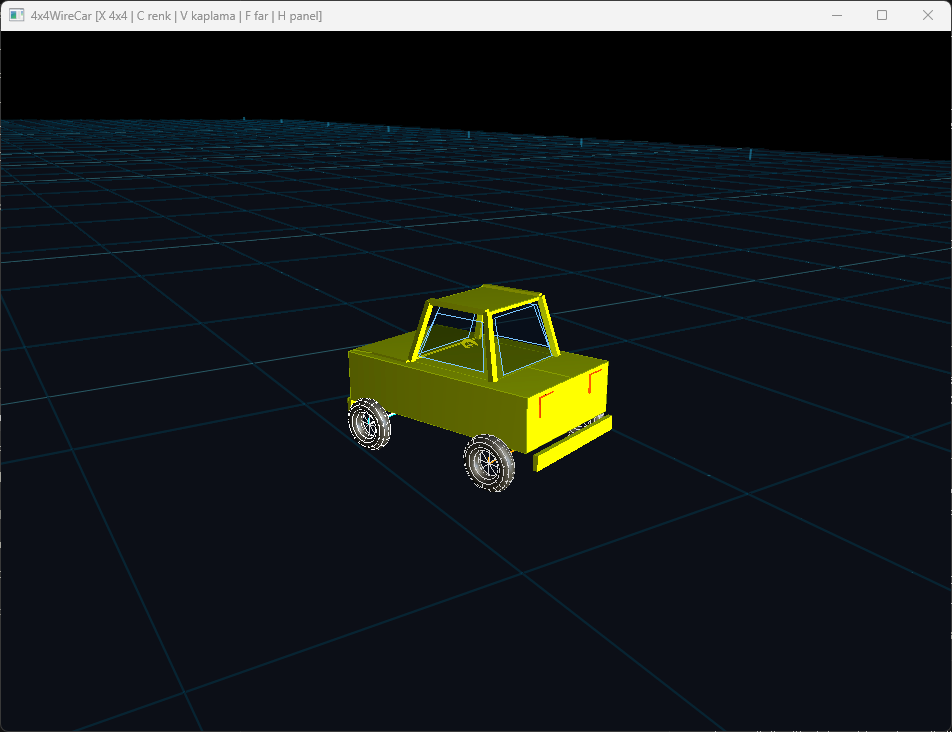
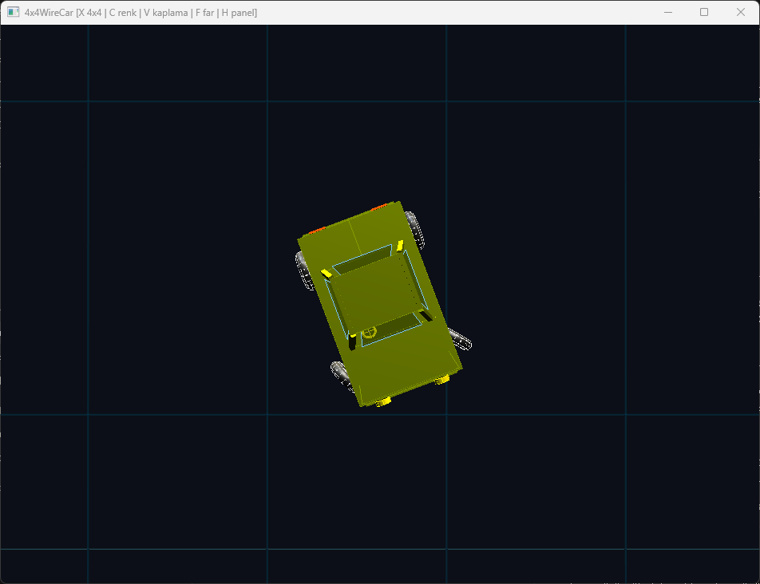
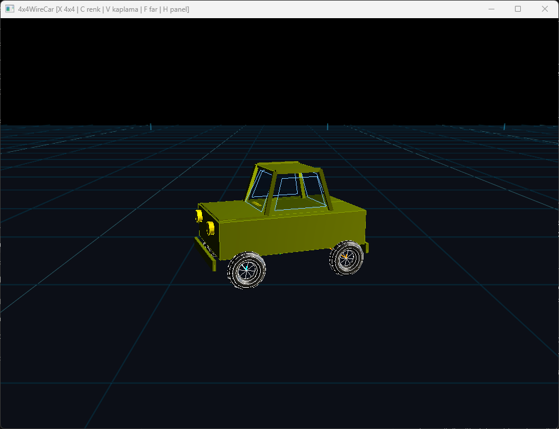
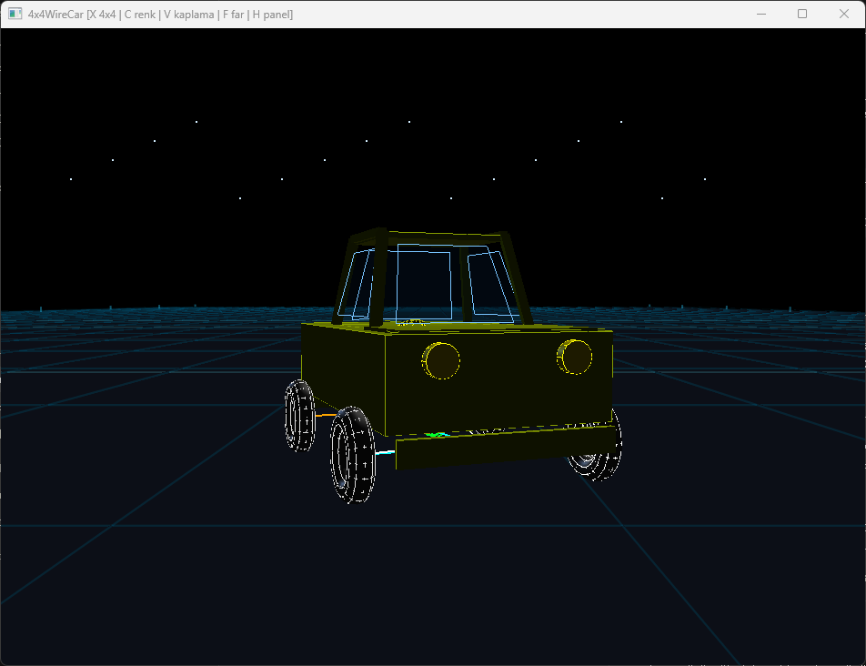
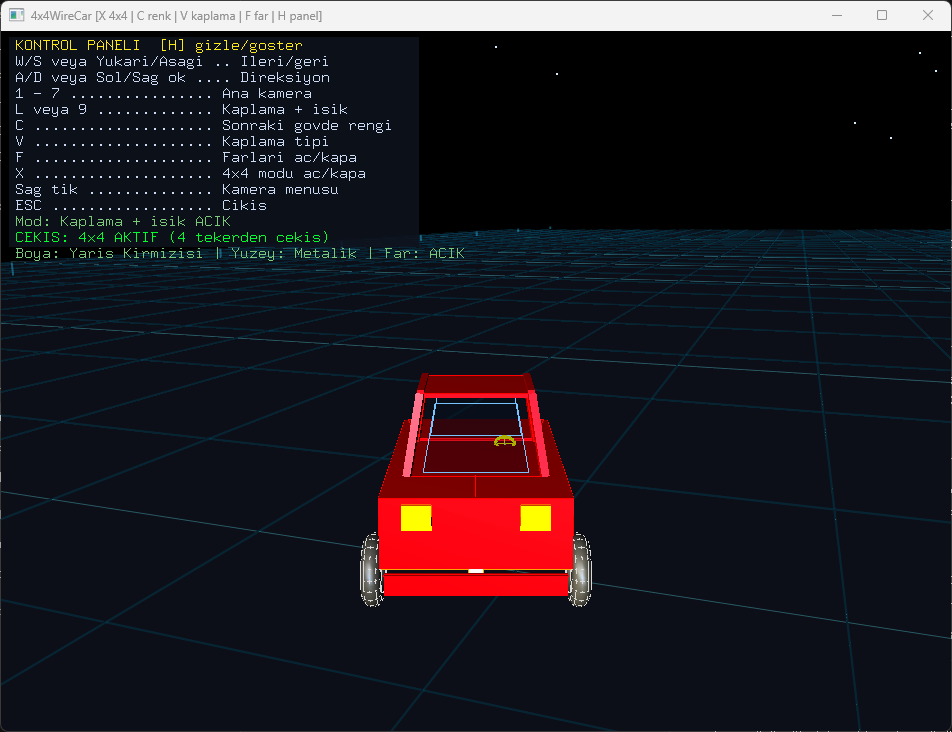
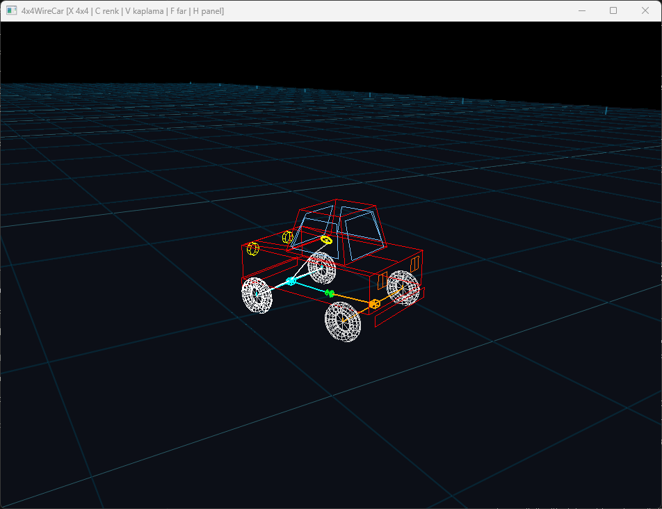
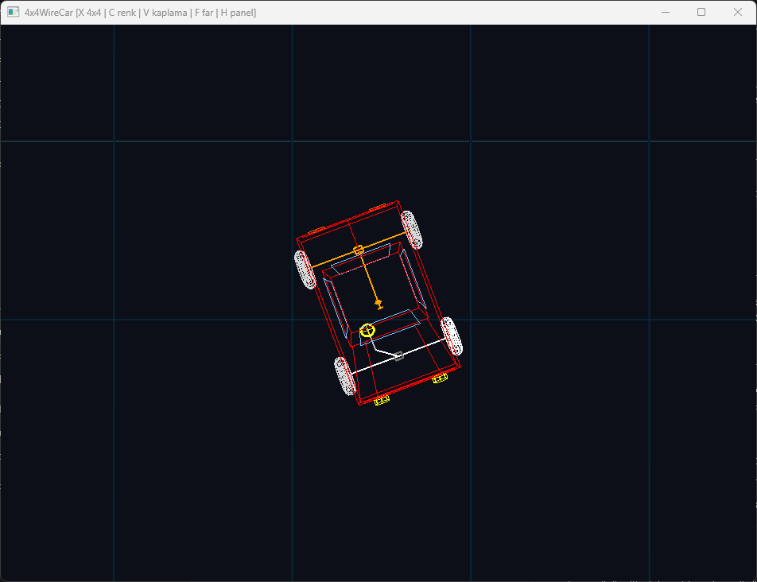
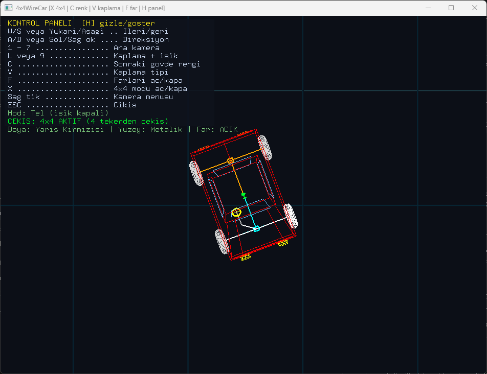
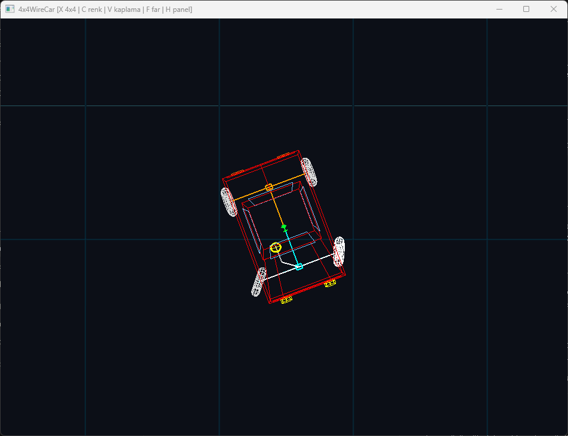

# 4x4 WireCar: A Drivable Wireframe Automobile in OpenGL and GLUT

**Subtitle:** Computer Graphics Project Report — Wire Primitives, Hybrid Shading, Driving Model and Switchable 4×4 Drivetrain

**Author:** Ömer Kaya  
**Date:** July 2026 (version 2.0; earlier versions 1.0 and 1.1 are tagged in the repository)  
**Repository:** WireCar (`wire_car/main.cpp`, `Makefile`, `figures/`)

---

## Abstract

This report documents version 2.0 of *Tel Araba* (WireCar), a three-dimensional car model written in C-style C++ with the OpenGL fixed-function pipeline and GLUT. The required geometry is the same as in the earlier versions: `glutWireCube` for the chassis, `glutWireTorus` for the wheels and the steering wheel, and line segments for the axles, driveshafts and steering linkage. Solid surfaces, paint colours and finishes, studio lighting and headlights from version 1.1 are kept. The main change is that the car can now be driven: it accelerates, brakes, reverses and turns on a large ground plane, using a simple kinematic bicycle model and Ackermann steering for the front wheels. A 4×4 mode can be switched on and off; it changes the acceleration, the drivetrain colours and which gears turn. The second preview window of the earlier versions was dropped in favour of a single larger driving view with seven cameras that follow the car.

---

## 1. Introduction

In versions 1.0 and 1.1 the car stayed at the origin and only the road markings and wheels moved, so the car looked like it was driving without actually changing position. For version 2.0 the goal was to make it drivable while keeping the assignment requirements:

1. **Compliance** — keep the required GLUT wire primitives for the body, wheels and steering wheel, and the line geometry for axles and driveshafts.
2. **Driving** — forward/backward movement with acceleration and braking, steering that depends on speed, and turning that matches the front wheel angle.
3. **Drivetrain** — a visible difference between four-wheel drive and rear-wheel drive.
4. **Cameras** — cameras that move with the car, including a smooth follow camera.

All code is in [`wire_car/main.cpp`](wire_car/main.cpp), built with the [`Makefile`](Makefile) or the Visual Studio solution [`wire_car.sln`](wire_car.sln).

---

## 2. Methodology

### 2.1 Development tools

| Component | Choice |
|-----------|--------|
| Language | C++ (written in C style, single file) |
| Compiler | `g++ -Wall -O2` (Makefile) or MSVC (Visual Studio solution) |
| Graphics | OpenGL 1.x, GLU quadrics |
| Toolkit | GLUT / FreeGLUT |
| Math | `<math.h>` (`sinf`, `cosf`, `tanf`, `atanf`, `fabsf`) |

### 2.2 Build and run

```bash
make                 # Linux
make PLATFORM=mac    # macOS
make PLATFORM=win    # Windows (MinGW + FreeGLUT)
./wire_car
```

### 2.3 Coordinate system

The car model is still built around **(0, 0, 0)** with **Z** forward, **Y** up and **X** left–right, so the drawing code from version 1.1 did not have to change. Driving is handled by one extra transform: `drawMovingCar` translates the whole car to `(carTravelX, 0, carTravelZ)` and rotates it by `carHeading` around **Y**.

| Constant | Value | Meaning |
|----------|-------|---------|
| `VEHICLE_WHEELBASE` | 1.24 | Distance between front and rear axles |
| `VEHICLE_TRACK` | 1.24 | Distance between left and right wheels |
| `MAX_STEER` | 30° | Steering limit at low speed |
| `HIGH_SPEED_STEER` | 12° | Steering limit at top speed |
| `MAX_FORWARD_SPEED` | 2.15 | Top speed forward (world units/s) |
| `MAX_REVERSE_SPEED` | 1.05 | Top speed in reverse |

### 2.4 Frame update

The timer still runs every 16 ms, but the movement no longer assumes a fixed frame rate. Each tick measures the elapsed time with `glutGet(GLUT_ELAPSED_TIME)` and uses it as `dt`, clamped between 1 ms and 50 ms so that the car does not jump when the window is dragged or the program is paused in a debugger.

---

## 3. Implementation

### 3.1 Speed

`moveTowards(current, target, maxChange)` moves a value towards a target by at most `maxChange`. Speed is updated with it every tick:

| Situation | Change per second |
|-----------|-------------------|
| Accelerating, 4×4 on | +1.90 |
| Accelerating, rear-wheel drive | +1.65 |
| Pressing the opposite direction while moving (braking) | 3.80 towards 0 |
| Reversing | 1.35 up to the reverse limit |
| No key pressed (rolling resistance) | 0.82 towards 0 |

### 3.2 Steering

`updateSteering(dt)` turns the wheels towards a target angle at 92°/s, and back to centre at 125°/s when the key is released. The allowed angle shrinks linearly from 30° at standstill to 12° at top speed, which keeps the car from spinning around at high speed:

```cpp
allowedSteer = MAX_STEER - (MAX_STEER - HIGH_SPEED_STEER) * speedRatio;
targetSteer = steerInput * allowedSteer;
```

### 3.3 Ackermann front wheels

When a car turns, the inner front wheel has to turn more than the outer one because it follows a smaller circle. `getFrontWheelSteer` computes the turn radius from `steerAngle` and the wheelbase, then gives each front wheel its own angle:

```cpp
turnRadius = VEHICLE_WHEELBASE / tanf(absSteer * PI / 180.0f);
innerAngle = atanf(VEHICLE_WHEELBASE / (turnRadius - VEHICLE_TRACK * 0.5f)) * 180.0f / PI;
outerAngle = atanf(VEHICLE_WHEELBASE / (turnRadius + VEHICLE_TRACK * 0.5f)) * 180.0f / PI;
```

`drawWheel` now takes the steering angle of that wheel as a parameter instead of a front/rear flag.

### 3.4 Movement (kinematic bicycle model)

The car is treated as one front and one rear wheel on the centre line. For a distance `movement = carSpeed * dt` the heading changes by

```
headingChange = movement / WHEELBASE * tan(steerAngle)
```

and the position moves along the average of the old and new heading. When reversing `movement` is negative, so the heading change is reversed as it would be in a real car. The car is kept inside the area |X| ≤ 20, |Z| ≤ 105; if it reaches the edge its speed is set to zero.

The wheel spin follows the distance travelled (`360° / (2π · 0.16)` per unit, 0.16 being the tyre radius), so the wheels no longer turn when the car is standing still.

### 3.5 4×4 mode

**X** toggles `fourWheelDriveEnabled`:

| | 4×4 on | 4×4 off (rear-wheel drive) |
|-|--------|----------------------------|
| Front axle lines | cyan | grey |
| Front driveshaft | drawn | not drawn |
| Front gear | turns | stopped |
| Transfer case | green | orange |
| Acceleration | 1.90 | 1.65 |

The rear axle (orange) always turns. The help panel shows *CEKIS: 4x4 AKTIF* or *CEKIS: 4x4 PASIF*.

### 3.6 Ground

The road with lane lines was replaced by a large dark ground plane (68 × 280 units) with a two-level cyan grid, posts along both sides, block silhouettes on the horizon and a few points as stars. The grid gives a sense of speed and direction without suggesting that the car has to stay in a lane.

### 3.7 Cameras

There is one window (950×700). The seven camera presets are the same as before, but they are now offset by the car's position so they move with it. Camera 7 is the default; it is also rotated with `carHeading` and moves towards its target by 12–16% per frame, which gives a smooth follow camera instead of one rigidly attached to the car.

The sub-window of versions 1.0 and 1.1 was removed together with its camera table, display and reshape callbacks and the **Q/E/R/T/Y** keys.

### 3.8 Kept from version 1.1

- Six body colours (**C**) and gloss/matte/metallic finishes (**V**)
- Key and fill lights (`GL_LIGHT0`, `GL_LIGHT1`) and two headlight spotlights (`GL_LIGHT2`, `GL_LIGHT3`, **F**)
- Solid + lighting / wire-only toggle (**L** or **9**)
- Right-click menu and help panel (**H**)

---

## 4. Results and Discussion

The screenshots below were taken from version 2.0 running on Windows (MinGW-w64 + FreeGLUT). The car was first driven forward while turning left (A), so in most views it is no longer at the origin or facing straight ahead.

### 4.1 Solid + lighting



*Figure 1: Default follow camera (7) after driving forward and turning left. The help panel shows the mode, the drive mode (4×4 on) and the paint settings.*



*Figure 2: Camera 1. The camera keeps its offset from the car, so the car stays in view after driving.*



*Figure 3: Camera 2 (top) while A (left) is held. The car is no longer facing straight ahead after the earlier left turn.*



*Figure 4: Camera 3 (side) on the grid ground plane.*



*Figure 5: Camera 5 (front) with the headlights on. Stars are visible behind the car.*



*Figure 6: Follow camera after changing the colour (racing red) and the finish (metallic).*

### 4.2 Wire only and the 4×4 drivetrain



*Figure 7: Wire-only mode, camera 1. 4×4 on: cyan front axle and front driveshaft, green transfer case, orange rear axle.*



*Figure 8: Wire-only mode, top view, 4×4 off. The front driveshaft is not drawn and the front differential box is grey.*



*Figure 9: Same view with 4×4 on again. The panel shows "Mod: Tel (isik kapali)" and "CEKIS: 4x4 AKTIF".*



*Figure 10: Top view while D (right) is held. The two front wheels are turned by different angles (Section 3.3).*

### 4.3 Discussion

The required wire primitives are still visible in every mode, and the driving code only adds one transform around the existing car drawing, so the geometry from version 1.1 did not have to change.

Limitations: the ground is flat, there are no obstacles or collisions apart from the edge of the area, there is no suspension or tyre slip, and the far clipping plane (100 units) is shorter than the ground, so the far end of the grid is cut off.

---

## 5. Conclusion

Version 2.0 turns WireCar from an animation into a small driving demo. The required wire primitives are unchanged, and the new parts are a time-based speed model, speed-dependent steering, Ackermann front wheels, a bicycle-model turning calculation, a switchable 4×4 drivetrain and cameras that follow the car.

Possible next steps: obstacles or a track, collisions, and suspension movement.

---

## References

1. Shreiner, D., et al. *OpenGL Programming Guide: The Official Guide to Learning OpenGL* (OpenGL Red Book). Addison-Wesley.
2. Kilgard, M. J. *The OpenGL Utility Toolkit (GLUT) Programming Interface*. Silicon Graphics, Inc.
3. Khronos Group. OpenGL 1.x Specification and Reference Pages. https://www.khronos.org/opengl/
4. FreeGLUT Project Documentation. http://freeglut.sourceforge.net/

---

## Appendix A: Controls

| Input | Action |
|-------|--------|
| **W** / **Up arrow** | Accelerate forward / brake when reversing |
| **S** / **Down arrow** | Brake / reverse |
| **A** / **Left arrow** | Steer left |
| **D** / **Right arrow** | Steer right |
| **1** – **7** | Camera preset (7 = follow camera, default) |
| **X** | 4×4 on / off |
| **L** or **9** | Solid + lighting / wire only |
| **C** | Next body colour |
| **V** | Next paint finish |
| **F** | Headlights on / off |
| **H** | Show / hide help panel |
| **Right click** | Menu: cameras, colour, finish, headlights, mode, exit |
| **ESC** | Exit |
